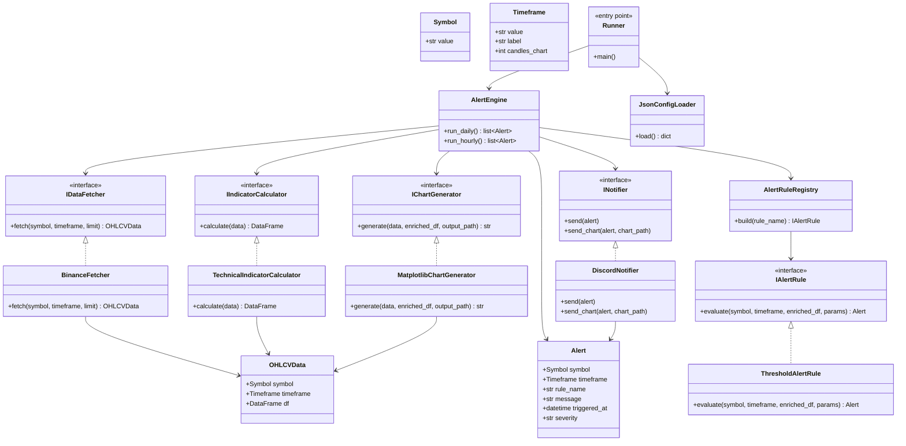

# CryptoAnalyzer

CryptoAnalyzer est une application Python orientée architecture qui récupère des données OHLCV depuis Binance, calcule des indicateurs techniques, applique des règles d’alerte et publie des alertes sur Discord avec un graphique associé.

## Architecture

L’application suit une architecture en couches et repose sur des abstractions pour garder le code modulaire.



## Composants principaux

- Fetcher : récupère les bougies OHLCV depuis Binance
- Indicateurs : calcule les SMA, RSI, MACD et Bollinger
- Règles : déclenchent des alertes selon des conditions configurables
- Moteur : orchestre l’ensemble du pipeline
- Notifier : envoie les alertes et graphiques vers Discord

## Structure du projet

```text
src/
  alerts/
  charts/
  engine/
  fetchers/
  indicators/
  notifiers/
  config_loader.py
  interfaces.py
```

## Installation

Prérequis :
- Python 3.10+
- pip

Installation des dépendances :

créer un venv et installer les dépendances

```bash
python3 -m venv .venv
source .venv/bin/activate
python3 -m pip install -r requirements.txt
```

## Configuration

Le projet lit sa configuration depuis le dossier [config](config).

Fichiers principaux :
- [config/settings.json](config/settings.json) : configuration active
- [config/settings_epxple.json](config/settings_epxple.json) : exemple de configuration

Points de configuration importants :
- `symbols` : paires à surveiller
- `timeframes` : périodes de temps utilisées
- `discord.webhook_urls.daily` : webhook des alertes quotidiennes
- `discord.webhook_urls.hourly` : webhook des alertes horaires
- `discord.webhook_urls.weekly` : webhook des alertes hebdomadaires
- `discord.channel_ids.daily` : salon des alertes quotidiennes et du nettoyage du webhook daily
- `discord.channel_ids.hourly` : salon des alertes horaires et du nettoyage du webhook hourly
- `discord.channel_ids.weekly` : salon des alertes hebdomadaires et du nettoyage du webhook weekly
- `scripts/clean_discord_messages.py` : nettoie les anciens messages de tous les webhooks listés dans `discord.webhook_urls`
- `discord.bot_token` : token du bot Discord utilisé par le script de nettoyage
- `alert_daily` : règles d’alerte appliquées à la timeframe quotidienne (`1d`)
- `alert_hourly` : règles d’alerte appliquées à la timeframe horaire (`1h`)
- `alert_weekly` : règles d’alerte appliquées à la timeframe hebdomadaire (`1w`)

Les commandes `daily`, `hourly` et `weekly` acceptent `--no-notifier` pour lancer
une analyse sans envoyer de notifications. La commande `simulate` n’utilise pas
non plus de notifier. Dans ces modes, la configuration Discord n’est pas validée ;
les autres paramètres restent soumis à validation.

## Exemple de configuration JSON

```json
{
  "symbols": ["BTCUSDC", "ETHUSDC"],
  "timeframes": [
    {"value": "1h", "label": "1 heure", "candles_chart": 48},
    {"value": "1d", "label": "1 jour", "candles_chart": 90}
  ],
  "discord": {
    "webhook_urls": {
      "daily": "https://discord.com/api/webhooks/...",
      "hourly": "https://discord.com/api/webhooks/...",
      "weekly": "https://discord.com/api/webhooks/..."
    },
    "channel_ids": {
      "daily": "ID_DU_SALON_DAILY",
      "hourly": "ID_DU_SALON_HOURLY",
      "weekly": "ID_DU_SALON_WEEKLY"
    },
    "bot_token": "VOTRE_TOKEN_DE_BOT"
  },
  "alert_daily": [
    {
      "id": "DRSIHIGH",
      "name": "rsi_high",
      "type": "threshold",
      "timeframes": ["1d"],
      "severity": "WARNING",
      "conditions": [
        {
          "indicator": "rsi_14",
          "operator": ">",
          "value": 70
        }
      ]
    }
  ],
  "alert_hourly": [
    {
      "id": "HVARIATION",
      "name": "hourly_variation",
      "type": "hourly_variation",
      "timeframes": ["1h"],
      "threshold_pct": 3.0,
      "severity": "WARNING",
      "message_tpl": "Variation horaire de {variation_pct}% sur {symbol} [{tf}]"
    }
  ],
  "alert_weekly": [
    {
      "id": "WLMACDUP",
      "name": "weekly_macd_bullish_candle",
      "type": "threshold",
      "timeframes": ["1w"],
      "severity": "WARNING",
      "message_tpl": "Signal hebdomadaire — MACD précédent={macd_line_1}, MACD actuel={macd_line}",
      "conditions": [
        {
          "left": {"indicator": "macd_line", "offset": 1},
          "operator": ">",
          "right": {"indicator": "macd_line", "offset": 0}
        },
        {
          "left": {"indicator": "close", "offset": 0},
          "operator": ">",
          "right": {"indicator": "open", "offset": 0}
        }
      ]
    }
  ]
}
```

## Utilisation

Exemples de lancement :

```bash
python -m src.engine.runner daily
python -m src.engine.runner hourly
python -m src.engine.runner weekly
python -m src.engine.runner simulate
python -m src.engine.runner chart BTCUSDC 1d
```

La commande `simulate` évalue les règles `alert_daily` et `alert_weekly`
sur les 30 derniers jours glissants, en UTC. Elle affiche les étapes de
récupération et de calcul, puis un DataFrame Polars avec `date`, `symbol` et
`alert_id`. Cette simulation ne publie aucune alerte sur Discord.

## Nettoyage des messages Discord

Le script `scripts/clean_discord_messages.py` supprime les messages anciens envoyés par tous les webhooks listés dans `discord.webhook_urls`. Il utilise l'API Discord avec un token de bot, car un webhook seul ne peut pas parcourir l'historique.

Le bot doit avoir accès à l'historique du salon ou du fil et la permission de gérer les messages. Renseignez son token dans `discord.bot_token` du fichier de configuration, puis lancez d'abord une simulation :

```bash
python scripts/clean_discord_messages.py --dry-run
```

Sans `--dry-run`, les messages de plus de 7 jours sont supprimés. Modifiez cette durée avec `--days` :

```bash
python scripts/clean_discord_messages.py --days 14
```

## Nettoyage des fichiers de log

Le script `scripts/clean_old_logs.py` supprime les fichiers `*.log` du dossier `logs` et les graphiques `*.png` du dossier `charts_output` dont la date de dernière modification dépasse la durée indiquée. Il supprime les fichiers de plus de 7 jours par défaut et ne supprime pas les autres types de fichiers.

```bash
python scripts/clean_old_logs.py
```

Utilisez `--days` pour définir une autre durée de rétention, en jours. La valeur doit être un entier strictement positif :

```bash
python scripts/clean_old_logs.py --days 14
```

Les chemins des dossiers `logs` et `charts_output` sont déterminés à partir de l'emplacement du script ; la commande peut donc être lancée depuis un autre répertoire.

## Notes

Le projet est pensé pour être extensible : il est possible d’ajouter de nouveaux fetchers, indicateurs, règles d’alerte ou canaux de notification sans modifier le cœur du moteur.
